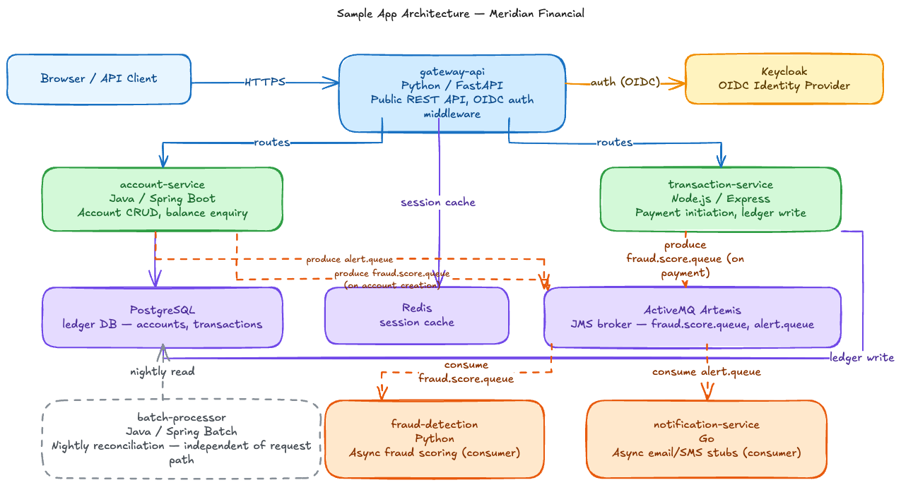

# Meridian Financial: Datadog implementation take-home exercise

Meridian Financial is a fictional mid-market financial services company. It processes payments, manages customer accounts, scores transactions for fraud, and runs a nightly reconciliation. This repository is their application: six microservices in Python, Java, Node.js and Go, running on Kubernetes.

**Your job is to implement Datadog for them, from scratch, in your own Datadog sandbox org.** Nothing in this repository installs or configures Datadog. You install the Agent, instrument the services, and build the monitors, SLOs and dashboards yourself, the way you would on a real customer engagement.

The Makefile only builds and deploys the application. Everything Datadog-related is yours to do.

- **Stuck?** Work through [TROUBLESHOOTING.md](./TROUBLESHOOTING.md) first. If you are still stuck, ask your Datadog Partner Solutions Architect for the reference implementation.
- **Hints and stretch goals:** [HINTS.md](./HINTS.md). Try each task on your own first.

---

## Contents

1. [How the exercise works](#how-the-exercise-works)
2. [Before you start](#before-you-start)
3. [The application](#the-application)
4. [Part A: Deploy the application](#part-a-deploy-the-application)
5. [Part B: Core tasks](#part-b-core-tasks)
6. [Part C: Stretch goals](#part-c-stretch-goals)
7. [Part D: Diagnosis exercises](#part-d-diagnosis-exercises)
8. [Clean up](#clean-up)
9. [Completion checklist](#completion-checklist)
10. [Reference](#reference)

---

## How the exercise works

| Part | What you do | Automated? |
|---|---|---|
| A | Build and deploy the app to a local Kubernetes cluster | Yes, `make build` and `make deploy-k8s` |
| B | Nine core Datadog tasks, each with a checkpoint | No, by hand |
| C | Stretch goals for deeper instrumentation | No, by hand |
| D | Three injected incidents to diagnose with what you built | The incident is injected for you, the diagnosis is yours |

Work through Part B in order. Later tasks depend on earlier ones. Each task gives you the goal, the docs to use, and a checkpoint. Do not move on until the checkpoint passes.

Keep notes as you go: what you changed, where, and why. A real customer would ask for exactly that.

---

## Before you start

| You need | Notes |
|---|---|
| A Datadog **sandbox** org with Admin access | Never use a customer or production org. |
| Your org's **Datadog site** | Match the URL you log in on: `app.datadoghq.com` is `datadoghq.com`, `app.datadoghq.eu` is `datadoghq.eu`, `us3.datadoghq.com`, `us5.datadoghq.com`, `ap1.datadoghq.com`. See [Datadog sites](https://docs.datadoghq.com/getting_started/site/). Every Datadog component you configure must use this site. |
| An **API key** | Organization Settings > API Keys. |
| An **Application key** | Only for the Terraform stretch goal. Use the key **value**, not the Key ID. |
| A local Kubernetes cluster | Docker Desktop with Kubernetes enabled is the simplest. Rancher Desktop, kind, k3d, minikube and Colima also work (see [Loading images](#loading-images-into-your-cluster)). |
| `docker`, `kubectl`, `helm`, `make` | Run from macOS, Linux, or WSL2 on Windows. |
| `terraform` 1.5 or later | Only for the optional [AWS EKS path](./EKS.md) and the Terraform stretch goal. |

Give your local cluster enough CPU and memory. It runs 12 application pods before you add Datadog. If pods stay `Pending`, raise the limits in your Docker Desktop or Colima settings.

---

## The application

```
                     ┌──────────────────────────────────────────────────────┐
                     │              traffic-generator (in-cluster)          │
                     │         continuous realistic load, always on         │
                     └────────────────────────┬─────────────────────────────┘
                                              │
                     ┌────────────────────────▼─────────────────────────────┐
                     │                  NGINX (reverse proxy)               │
                     └────────────────────────┬─────────────────────────────┘
                                              │
                     ┌────────────────────────▼─────────────────────────────┐
                     │            gateway-api  (Python / FastAPI)           │
                     │          REST API · OIDC auth middleware · :8080     │
                     └──────────────────┬───────────────────┬───────────────┘
                                        │                   │
          ┌─────────────────────────────▼──┐   ┌───────────▼────────────────────┐
          │  account-service               │   │  transaction-service           │
          │  Java / Spring Boot · :8081    │   │  Node.js / Express · :8082     │
          │  Account CRUD · balance        │   │  Payment initiation · ledger   │
          └────────────────┬───────────────┘   └──────────┬─────────────────────┘
                           │  JMS → fraud.score.queue,     │  STOMP → fraud.score.queue
                           │  alert.queue                  │
                     ┌─────▼───────────────────────────────▼───────────────┐
                     │           ActiveMQ Artemis  (JMS 2.0 broker)        │
                     └────────────────┬──────────────────────┬─────────────┘
                                      │                      │
               ┌──────────────────────▼────┐    ┌───────────▼──────────────────┐
               │  fraud-detection (Python) │    │  notification-service (Go)   │
               │  async scoring consumer   │    │  email / SMS stub consumer   │
               └───────────────────────────┘    └──────────────────────────────┘

                     ┌──────────────────────────────────────────────────────┐
                     │      batch-processor  (Java / Spring Batch)          │
                     │      reconciliation and statement jobs · :8083       │
                     └──────────────────────────┬───────────────────────────┘
                                                │
                     ┌──────────────────────────▼───────────────────────────┐
                     │     PostgreSQL  (ledger DB)   Redis  (session cache) │
                     └──────────────────────────────────────────────────────┘
```



| Service | Language | Port | Role |
|---|---|---|---|
| `gateway-api` | Python (FastAPI) | 8080 | Public REST API, OIDC auth, request routing |
| `account-service` | Java (Spring Boot) | 8081 | Account CRUD, balance enquiry, JMS producer |
| `transaction-service` | Node.js (Express) | 8082 | Payment initiation, ledger write, STOMP producer |
| `fraud-detection` | Python | none | Async fraud scoring, queue consumer |
| `notification-service` | Go | none | Async email and SMS stubs, queue consumer |
| `batch-processor` | Java (Spring Batch) | 8083 | Reconciliation and statement jobs |
| `traffic-generator` | Python | none | Continuous load. Tooling, not part of Meridian's app |

Supporting infrastructure: PostgreSQL 15 (`postgres-ledger`), Redis 7, ActiveMQ Artemis, Keycloak 26 (OIDC for the app, and a SAML client you can use for Datadog SSO), and NGINX.

Each service folder has a short README with its endpoints. Kubernetes manifests are in `deploy/kubernetes/base/`.

---

## Part A: Deploy the application

```bash
make build
# kind / k3d / minikube / Colima only: load the images now, see "Loading images" below
make deploy-k8s
```

**Checkpoint A**
- `kubectl get pods -n finance` shows 12 pods `Running`.
- `kubectl logs -n finance deploy/traffic-generator -f` shows 200 and 201 responses, not a wall of 401s.
- Open `https://localhost:30443` once and accept the self-signed certificate warning. Then open `http://localhost:30080` and log in as `carol.admin` / `Finance@2025!`.

---

## Part B: Core tasks

Throughout Part B:
- **Your Datadog configuration lives with you.** Create a folder such as `datadog/` in your copy of the repo for your Agent manifest and notes.
- **Manifest changes** to the services go in `deploy/kubernetes/base/services/*.yaml`. Apply them with `make deploy-k8s`, which re-applies every manifest.
- **New Agent config only affects pods created after it.** When a task changes what the Agent injects into pods, restart the app with `kubectl rollout restart deployment -n finance`.
- **Pick one `env` value** for this exercise, for example `sandbox`, and use it everywhere.

### Task 1: Install the Datadog Agent

**Goal:** a Datadog Agent on every node and a Cluster Agent, installed with the Datadog Operator, reporting to your sandbox org.

**Do:**
- Install the Datadog Operator with Helm into its own namespace, for example `datadog`. Do not use `finance`.
- Store your API key in a Kubernetes Secret. Never put it in a manifest.
- Write a `DatadogAgent` resource. Set your site and a cluster name, and only enable what you need now. You will add features in later tasks.

**Docs:** [Install the Agent on Kubernetes](https://docs.datadoghq.com/containers/kubernetes/installation/), [Datadog Operator](https://docs.datadoghq.com/containers/datadog_operator/)

**Checkpoint 1**
- Agent and Cluster Agent pods are `Running`.
- `agent status` inside an Agent pod shows a valid API key.
- Your cluster appears under **Infrastructure > Kubernetes** in your org, and the `finance` pods appear in the Containers view.

### Task 2: Unified Service Tagging

**Goal:** every service reports a consistent `env`, `service` and `version`, so all its telemetry can be correlated.

**Do:** add the standard tagging labels and environment variables to each of the six service Deployments. Use the folder name as the `service` value, for example `gateway-api`. The services already read `DD_SERVICE`, `DD_ENV` and `DD_VERSION` into their JSON logs, so setting these also fixes the log fields.

**Docs:** [Unified Service Tagging](https://docs.datadoghq.com/getting_started/tagging/unified_service_tagging/)

**Checkpoint 2:** in the Containers view, filtered to `kube_namespace:finance`, each container carries `env`, `service` and `version` tags.

### Task 3: Log collection

**Goal:** the `finance` services' logs arrive in Datadog, parsed and tagged with the right `service` and `source`.

**Do:** enable log collection on the Agent, and use Autodiscovery annotations on the pods to set each service's `source` and `service`. The services log JSON to stdout. Decide whether to collect from every container or only from annotated ones, and be ready to explain your choice.

**Docs:** [Kubernetes log collection](https://docs.datadoghq.com/containers/kubernetes/log/)

**Checkpoint 3:** in Log Explorer, `kube_namespace:finance` returns logs with the `service` facet populated, JSON fields parsed into attributes, and error logs showing error status.

### Task 4: APM with Single Step Instrumentation

**Goal:** distributed traces from the Python, Java and Node.js services, with no code changes.

**Do:** enable Single Step Instrumentation through your `DatadogAgent`, scoped to the `finance` namespace, then restart the app. That covers `gateway-api`, `fraud-detection`, `account-service`, `batch-processor` and `transaction-service`. `notification-service` is Go, which Single Step Instrumentation does not support. Go is a stretch goal. Leave `traffic-generator` uninstrumented: it is tooling, not part of Meridian's app.

**Docs:** [Single Step APM Instrumentation on Kubernetes](https://docs.datadoghq.com/tracing/trace_collection/automatic_instrumentation/single-step-apm/kubernetes/)

**Checkpoint 4**
- **APM > Services** lists the five services under your `env`.
- The service map shows `gateway-api` calling `account-service` and `transaction-service`, plus PostgreSQL, Redis and the message broker.
- A `POST /v1/payments` trace shows one flame graph spanning `gateway-api` and `transaction-service`.

### Task 5: Connect logs and traces

**Goal:** from a log line, jump to its trace, and from a trace, to its logs.

**Do:** turn on trace ID injection into logs for the Python, Java and Node.js services. Each language handles it differently. See the language notes in [HINTS.md](./HINTS.md#task-5-log-and-trace-correlation) if you get stuck.

**Docs:** [Correlate logs and traces](https://docs.datadoghq.com/tracing/other_telemetry/connect_logs_and_traces/)

**Checkpoint 5:** a log from each of `gateway-api`, `account-service` and `transaction-service` opens its trace, and the trace's Logs tab shows those logs.

### Task 6: Database Monitoring for PostgreSQL

**Goal:** query-level visibility into `postgres-ledger`: query metrics, samples and explain plans.

**Do:**
- Create a read-only monitoring user with the grants the docs list.
- Configure the Agent's Postgres check with Database Monitoring enabled, through Autodiscovery on the `postgres-ledger` StatefulSet. Keep the password out of plain text.

To get a `psql` shell: `kubectl exec -it -n finance statefulset/postgres-ledger -- psql -U finance -d ledger`. The required `pg_stat_statements` settings are already in `deploy/kubernetes/base/infrastructure/postgres.yaml`, so confirm them rather than changing them.

**Docs:** [Database Monitoring for self-hosted Postgres](https://docs.datadoghq.com/database_monitoring/setup_postgres/selfhosted/)

**Checkpoint 6:** **Databases** shows `postgres-ledger`, Query Metrics lists the app's queries, and at least one query sample has an explain plan.

### Task 7: Real User Monitoring and Session Replay

**Goal:** real browser sessions from the Meridian dashboard, with replays that do not expose financial data.

**Do:**
- Create a Browser RUM application in your org.
- Add the Browser SDK to `frontend-stub/index.html`, with `service`, `env` and `version` set. Enable Session Replay with a privacy level that masks what users type.
- Publish the change. The page is served from a ConfigMap, so rebuilding the image is not enough. Run `make deploy-k8s`, which rebuilds the ConfigMap, then `kubectl rollout restart deployment/frontend -n finance`.

**Docs:** [Browser RUM setup](https://docs.datadoghq.com/real_user_monitoring/browser/)

**Checkpoint 7:** after a minute of using the dashboard, the RUM Sessions explorer shows your session, and its replay shows masked input fields.

### Task 8: Security

**Goal:** App and API Protection on the instrumented services, plus Workload Protection and Misconfigurations on the cluster.

**Do:**
- Enable App and API Protection for the services you instrumented in Task 4.
- Enable Workload Protection and Misconfigurations in your `DatadogAgent`.

**Docs:** [App and API Protection](https://docs.datadoghq.com/security/application_security/), [Workload Protection on Kubernetes](https://docs.datadoghq.com/security/workload_protection/setup/kubernetes/)

**Checkpoint 8**
- App and API Protection lists your services as protected.
- Send one request that looks like a security scanner and find it as a security trace:
  ```bash
  kubectl port-forward svc/gateway-api 8080:8080 -n finance
  curl -A "dd-test-scanner-log" http://localhost:8080/health   # in a second terminal
  ```
- The security agent's status shows Workload Protection running. If it cannot run on your local cluster's kernel, write down why and move on.

### Task 9: Monitors, an SLO and a dashboard

**Goal:** Meridian's on-call team gets alerted on what matters and has one place to look. Build these **by hand in the Datadog UI**. The Terraform version is a stretch goal.

**Build:**
1. **APM monitor** on the payment endpoint (`gateway-api`, `POST /v1/payments`) for error rate or latency.
2. **A second monitor of your choice** on a different signal: logs, the database, or infrastructure.
3. **An SLO** for payment availability or latency, with a target and time window you can justify.
4. **A dashboard** called "Meridian Financial overview". Include request rate, errors and latency for the payment path, the database, the SLO, and your monitors' status.

Route each monitor's notification with tags rather than a hard-coded person, so it would survive team changes.

**Docs:** [Monitors](https://docs.datadoghq.com/monitors/), [Service Level Objectives](https://docs.datadoghq.com/service_management/service_level_objectives/), [Dashboards](https://docs.datadoghq.com/dashboards/)

**Checkpoint 9:** both monitors are in OK state with notifications configured, the SLO shows live data, and the dashboard renders data in every widget.

---

## Part C: Stretch goals

Pick any. Each one in [HINTS.md](./HINTS.md#stretch-goals) has a goal, a starting point, and a checkpoint.

| # | Stretch goal |
|---|---|
| S1 | Trace the Go `notification-service`. Single Step Instrumentation cannot do this one. |
| S2 | Add custom spans and tags around key business operations |
| S3 | Continuous Profiler |
| S4 | Data Streams Monitoring across the payment queue |
| S5 | Batch job visibility for `batch-processor` |
| S6 | ActiveMQ Artemis integration (JMX metrics) |
| S7 | Rebuild your Task 9 monitors, SLO and dashboard with Terraform |
| S8 | Datadog SSO with the bundled Keycloak (SAML) |
| S9 | Deployment Tracking with real versions |
| S10 | Connect RUM sessions to backend traces |
| S11 | Synthetic tests (needs EKS or a private location) |

---

## Part D: Diagnosis exercises

Each command below injects a realistic incident into the running app. Use only what you built to find the root cause. Each scenario is off by default and reversible.

| Scenario | Inject | Reset | Situation |
|---|---|---|---|
| 1 | `make scenario-1` | `make unscenario-1` | Customers report slow payment confirmations. Nothing is erroring. |
| 2 | `make scenario-2` | `make unscenario-2` | Finance says last night's reconciliation looks wrong, but the job reported success. Trigger a run: `kubectl port-forward deploy/batch-processor 8083:8083 -n finance`, then in a second terminal `curl -s -X POST localhost:8083/jobs/reconciliation`. |
| 3 | `make scenario-3` | `make unscenario-3` | Fraud alerts arrive long after each payment. Which service is actually responsible? |

For each scenario, write down:
1. The root cause, in one sentence.
2. The Datadog view that proved it. Take a screenshot.
3. The monitor that should have caught it. Build it if you have time.

Scenario 1 needs Tasks 4 and 6. Scenario 2 can be solved from logs, but is easier with stretch goal S5. Scenario 3 is easiest with stretch goal S4.

Reset each scenario before running `make deploy-k8s` again. Scenarios 2 and 3 change the Deployments directly, so a redeploy silently undoes them while `make` still treats them as applied.

---

## Clean up

Remove what you created in your sandbox when you are done:

```bash
make teardown        # deletes the finance namespace and volumes, plus a 'datadog' namespace and
                     # 'datadog-operator' Helm release if you used those names
```

If you used other names for your Agent namespace or Helm release, remove them yourself. Then delete the RUM application, monitors, SLO and dashboard you created in the Datadog UI, unless your Datadog contact wants to review them in your org.

---

## Completion checklist

- [ ] Part A: 12 pods `Running`, dashboard login works
- [ ] Task 1: Agent and Cluster Agent reporting to your org
- [ ] Task 2: `env`, `service`, `version` on every service
- [ ] Task 3: parsed, tagged logs from every service
- [ ] Task 4: traces from five services and a connected service map
- [ ] Task 5: logs and traces linked both ways
- [ ] Task 6: Query Metrics and an explain plan for `postgres-ledger`
- [ ] Task 7: a RUM session with masked Session Replay
- [ ] Task 8: App and API Protection, Workload Protection and Misconfigurations enabled
- [ ] Task 9: two monitors, an SLO and the "Meridian Financial overview" dashboard
- [ ] Part D: root cause and evidence for at least Scenario 1
- [ ] Stretch goals attempted (list them)
- [ ] Clean up done

**Send your Datadog contact:** your `DatadogAgent` manifest, the diff of your changes to the repo (`git diff`), screenshots for each checkpoint, and your Part D write-up.

---

## Reference

### Loading images into your cluster

`make build` tags images `finance-sample-app-<service>:latest`.

| Cluster | After `make build` |
|---|---|
| Docker Desktop, Rancher Desktop | Nothing. The cluster sees local images. |
| kind | `kind load docker-image finance-sample-app-<service>:latest` |
| k3d | `k3d image import finance-sample-app-<service>:latest` |
| minikube | `minikube image load finance-sample-app-<service>:latest` |
| Colima | `docker save finance-sample-app-<service>:latest \| colima ssh -- sudo ctr -n k8s.io image import -` |

The services are `gateway-api account-service transaction-service fraud-detection notification-service batch-processor`. If you change code, rebuild, reload, and run `make deploy-k8s`.

### Credentials

All local credentials are development defaults in `deploy/kubernetes/base/02-secrets.yaml`.

| Component | User | Password |
|---|---|---|
| PostgreSQL (`ledger` database) | `finance` | `finance_dev_password` |
| ActiveMQ Artemis | `admin` | `artemis_dev_password` |
| Keycloak admin console | `admin` | `Finance@Admin2025!` |

### URLs

| What | URL |
|---|---|
| Finance dashboard | `http://localhost:30080` |
| Keycloak admin console | `https://localhost:30443/admin/master/console/#/finance` |
| ActiveMQ console | `kubectl port-forward svc/activemq-artemis 8161:8161 -n finance`, then `http://localhost:8161` |

### Dashboard users

All users share the password `Finance@2025!`.

| User | Role | Can do |
|---|---|---|
| `alice.analyst` | analyst | View accounts and balances |
| `bob.trader` | trader | Analyst rights, plus payments and transfers |
| `carol.admin` | admin | Everything, including deposits, approvals and creating accounts |
| `dave.auditor` | auditor | View accounts and balances |
| `eve.compliance` | compliance | View accounts, approve or reject pending payments |

### Traffic generator

`traffic-generator` sends a steady mix of balance checks, payments, account lookups, health checks, deliberate errors (404, 401, 422) and occasional batch job triggers.

```bash
kubectl logs -n finance deploy/traffic-generator -f                     # watch
kubectl scale deployment traffic-generator --replicas=0 -n finance      # pause
kubectl scale deployment traffic-generator --replicas=1 -n finance      # resume
kubectl set env deployment/traffic-generator TRAFFIC_RATE=5 -n finance  # requests per second
```

### Makefile targets

Run `make help` for the full list. The main ones are `build`, `deploy-k8s`, `teardown`, the `scenario-N` and `unscenario-N` pairs, and the AWS targets.

### AWS EKS (optional)

You can run the app on EKS instead of a local cluster. It costs money, takes longer, and makes synthetic tests possible. See [EKS.md](./EKS.md).

### Security notes

- Never commit your API or Application keys. Keep them in Kubernetes Secrets.
- Treat card numbers, IBANs and balances as sensitive. Keep them out of tags, span names and log messages, and mask them in Session Replay.
- Every password in this repo is a development default. Rotate them before using this anywhere other than a sandbox.
